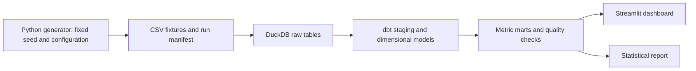

# Architecture and metric contracts

## Purpose and pipeline

Help a hypothetical support leader locate journey friction and decide what to investigate. All entities and results are synthetic. Definitions below are project choices.

Use local batch execution with one database writer. Dashboard reads only completed, validated runs. Failed builds must not appear as successful refreshes.

## Platform roadmap

The local pipeline is the first implementation milestone. The [business roadmap](business-roadmap.md) includes Power BI semantic modelling/reporting and an Azure submission-to-metric path for consistent executive reporting and reproducible deployment. Both must consume versioned metric contracts and reconcile against common golden cases. Streamlit provides exploration, with a validated synthetic snapshot for hosted demonstrations. Select Azure services after access, cost and deployment constraints are established; do not imply cloud deployment has occurred.

Add product and jurisdiction dimensions for mortgages, personal loans, auto loans and credit cards in AU/UK fixtures. Preserve original currency, local dates, submission/schema version and source institution; avoid implicit currency conversion or cross-market pooling. Product/jurisdiction eligibility belongs in each metric contract. Ingestion must return an auditable acceptance or rejection report and support corrected resubmissions without duplicate loading.

Advanced analytics requires separate versioned training and batch-scoring paths, time-based evaluation, external-series provenance, monitoring and rollback. No proprietary HAI/HSI implementation is intended. Market-specific regulatory claims require a current primary-source applicability review.

## Model grains

| Model | Grain and key rules |
| --- | --- |
| dim_customer | One fictional customer; no contact details or free text |
| dim_institution | One fictional institution; no real lender rankings |
| dim_date | One date, reused for role-specific dates |
| fct_web_session | One session; customer ID optional |
| fct_engagement_event | One event with event ID, session ID, type and timestamp |
| fct_application | One request with customer, institution, notice, decision and status |
| fct_assistance | One assistance episode linked to an approved request |
| fct_account_month | One account per month with payment status and observation flag |
| dim_learning_content | One versioned learning asset; question definitions versioned separately |
| fct_learning_response | One response event; question version, correctness and optional confidence kept distinct |
| fct_support_contact | One logged contact event linked to request/assistance, with timestamp and purpose |

First release: at most one request per customer and one episode per request. Accounts remain explicit; outcomes use the assisted account. Include anonymous sessions and unlinked applications from other channels. Never infer anonymous identity. Aggregate facts to the required grain before joining to avoid multiplying counts.

Literature refinement: [review](literature-review.md). Learning exposure, completion, correctness, confidence and subsequent action are separate constructs. Report first-response correctness by question version and response coverage against eligible exposure; do not pool arbitrary questions. Missing contact records mean unknown capture unless logging completeness is established. Capture content/event schema versions in the manifest. Include contact before assistance expiry as an exploratory grouping, with targeting/selection limitations.

## Metric contracts

Use a configured observation cutoff independent of today's date. Show cohort dates, numerators, denominators and exclusions. Zero denominators display as unavailable.

| Metric | Numerator or statistic | Denominator and eligibility |
| --- | --- | --- |
| Contact progression | Sessions with contact start within 24 hours | Support sessions at least 24 hours old at cutoff |
| Observed session exit | Eligible sessions without contact start within 24 hours | Same eligible sessions; recorded behaviour, not confirmed hardship abandonment |
| Application dropout | Explicit withdrawn/lost-contact closures | All cohort requests; show pending, approved and declined separately |
| Decision time | Median calendar days from notice to decision | Decided requests; display pending count and age alongside |
| Early contact share | Requests with zero days past due at notice | Requests with observed arrears at notice; report unknowns |
| Three month-end payment stability | Assisted accounts current at each of the first three month-ends strictly after assistance ends | Episodes with all three observations due by cutoff and all observed; not an exact 90-day window |

Show immature and missing-follow-up episodes separately. Display outcome coverage against all mature episodes. Payment stability is an operational proxy, not proof of wellbeing or sustainable recovery.

## Simulation and analysis

Version seed, configuration, cutoff, source hashes and row counts in a manifest. Generate chronological events; exclude future records from marts. Configuration exposes assumed engagement, arrears, channel and outcome probabilities. Do not present these assumptions as estimated population parameters.

Compare early/later contact groups using sizes, rates, Wilson intervals and a percentage-point difference. Stratify by initial arrears and channel where feasible. Confidence intervals illustrate statistical technique; they do not validate the generator or estimate real-world effects. Discuss selection, confounding and missing follow-up. A causal evaluation requires a separately designed study.

## Quality and governance

Check unique keys, nulls, accepted states, foreign keys, chronology, non-negative arrears, cutoff enforcement and funnel reconciliation. Pending requests must have no decision date; assistance must follow approval. Outcomes must refer to the assisted account. Identical inputs must reproduce source hashes and metrics.

Keep generated source data, databases, secrets and environments out of git. A compact validated synthetic dashboard snapshot is deliberately versioned for sharing. CI uses synthetic fixtures. Dashboard shows run metadata, quality status and a persistent synthetic notice. Suppress rates below 20 observations as a demonstration rule, not a privacy guarantee. Production use would require purpose limits, access controls, retention, linkage review and accountable metric owners.
